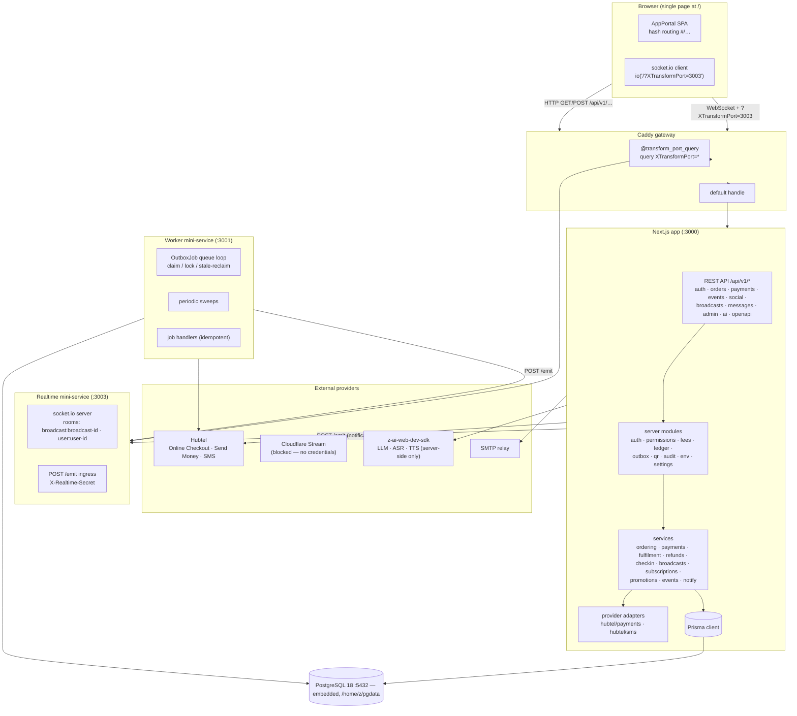

# iEventPlux — Architecture

| | |
|---|---|
| **System** | iEventPlux events discovery, ticketing, social & broadcasting platform |
| **Deployment in this repo** | Next.js 16 App Router app + worker mini-service (:3001) + realtime mini-service (:3003) behind a Caddy gateway |
| **Data** | Prisma ORM on **PostgreSQL 18** (embedded, user-space, :5432 — `bun run db:postgres`) with SQLite fallback (`db/custom.db`) |
| **API** | REST at `/api/v1` (versioned), OpenAPI document at `GET /api/v1/openapi` |

---

## 1. System diagram



Key property: **the database is the source of truth.** Both the API and the worker operate on the same SQLite file through Prisma; the realtime service is deliberately stateless (room membership and counts only). A crashed worker loses nothing — jobs are rows, not memory.

---

## 2. Component boundaries

### 2.1 Next.js app (:3000) — `src/`

| Layer | Contents | Notes |
|---|---|---|
| Single visible page | `src/app/page.tsx` → `src/portal/AppPortal.tsx` | The only user-visible route is `/`. All navigation is hash-based (§3). |
| REST API | `src/app/api/v1/**/route.ts` | Versioned under `/api/v1`; OpenAPI at `src/app/api/v1/openapi/route.ts`; health at `/api/v1/health`. |
| Portal views | `src/portal/views/*.tsx` | Discover, LiveNow, Reels, EffectsStudio, EventDetail, OrgProfile, AuthView, Me, OrderView, ClaimTicket, BroadcastView, OrganizerWorkspace, AdminConsole, CreateOrg. |
| Portal runtime | `src/portal/router.ts`, `api.ts`, `store.ts`, `format.ts`, `animate.ts` | Hash router, typed fetch client, client state, money/date formatting, jQuery view transitions. |
| Server core | `src/server/*.ts` | `auth.ts`, `permissions.ts`, `env.ts`, `api.ts`, `fees.ts`, `ledger.ts`, `money.ts`, `outbox.ts`, `qr.ts`, `audit.ts`, `ids.ts`, `settings.ts`. |
| Services | `src/server/services/*.ts` | Business logic per domain (orders, payments, fulfilment, refunds, checkin, broadcasts, subscriptions, promotions, events, notify). |
| Provider adapters | `src/server/hubtel/{payments,sms}.ts` | Explicit capability + verification-status headers; simulators isolated. |

### 2.2 Worker mini-service (:3001) — `mini-services/worker/`

- HTTP surface: `GET /health` (public), `GET /stats` (requires `X-Worker-Secret`) returning OutboxJob counts grouped by status.
- Main loop: every 5 s, enqueue due sweeps, then drain up to 20 jobs.
- **Queue semantics** (SQLite `OutboxJob` table):
  - **Claim:** find oldest `QUEUED` job with `runAt <= now` and (`lockedAt` null or older than 90 s) → atomic `updateMany` to `RUNNING` with `lockedBy = workerId` — a lost race means another worker claimed it.
  - **Stale reclaim:** locks older than 90 s are stealable, so a killed worker's jobs resume automatically.
  - **Retry:** on failure, `attempts++`, exponential backoff `min(5 min, 2 s · 2^attempts)`, re-`QUEUED`.
  - **DEAD:** after `maxAttempts` (default 5, sweeps 3) the job is parked as `DEAD` with `lastError` for operator review (admin console → outbox section; `docs/OPERATIONS.md`).
  - **Idempotency:** every handler is idempotent (payment fulfilment is guarded by order status + ledger idempotency keys; sweeps re-check state before acting), so retries never duplicate paid effects.
- **Core job types:** `SEND_MESSAGE`, `PROCESS_PROVIDER_EVENT`, `RECONCILE_PAYMENT`, `EVENT_LIFECYCLE`, `REMINDER_SWEEP`, `RESERVATION_SWEEP`, `SMS_STATUS_POLL`, `PLAYBACK_CLEANUP` (plus auxiliary `NOTIFY_PUSH` and `PROMOTION_BILL` types in `src/server/outbox.ts`).
- **Sweep cadence:** reservations 20 s · lifecycle 60 s · reconcile 60 s · SMS poll 30 s · reminders 300 s · playback cleanup 120 s (with an existing QUEUED/RUNNING job of the same type suppressing re-enqueue — no stampede).

### 2.3 Realtime mini-service (:3003) — `mini-services/realtime/`

- socket.io server; rooms `broadcast:{id}` (chat + presence) and `user:{id}` (notification push).
- **Authorization happens in the Next.js API** — chat messages are POSTed to `/api/v1/broadcasts/{id}/chat`, persisted, then relayed to the room via the authenticated ingress; the realtime service only relays.
- `POST /emit` ingress requires the `X-Realtime-Secret` header (API + worker are the only callers).
- Presence counts broadcast on join/leave/disconnect; typing indicators are ephemeral relays.
- HTTP surface on the same port: `GET /health`.
- Stateless by design: a restart drops connections (clients reconnect) but loses no durable state.

### 2.4 Gateway — `Caddyfile`

```caddyfile
@transform_port_query { query XTransformPort=* }
handle @transform_port_query { reverse_proxy localhost:{query.XTransformPort} … }
handle { reverse_proxy localhost:3000 … }
```

- The gateway exposes **one public origin**. Requests carrying `?XTransformPort=3003` are proxied to the realtime service; everything else goes to the Next.js app (:3000). (The worker's :3001 is reachable the same way for `/health`/`/stats`.)
- socket.io clients therefore connect with `io('/?XTransformPort=3003')` — a relative URL with the port **only** in the query parameter, keeping the engine.io path at its default so `/health` and `/emit` work on the same listener.
- Forwarded headers (`Host`, `X-Forwarded-For`, `X-Forwarded-Proto`, `X-Real-IP`) are set for both routes.

---

## 3. Single-page hash-router rationale

**Constraint:** the deployment gateway exposes only the Next.js app's `/` page as user-visible; app routes beyond the API are not individually addressable. API routes (`/api/v1/*`) are allowed and proxied.

**Decision:** the portal is one React app at `/` with a custom hash router (`src/portal/router.ts`):

| Route | View |
|---|---|
| `#/` | Discover (feed, categories, search) |
| `#/live` | Live now rail |
| `#/reels` | Reels feed (synthetic dev clips, labelled) |
| `#/effects` | CSS Effects Studio (38 effects, 10 categories) |
| `#/event/{slug}` | Event detail + checkout |
| `#/org/{slug}` | Organization profile |
| `#/signin`, `#/register` | Auth |
| `#/me` | My tickets, orders, saved, settings |
| `#/order/{ref}` | Order status + tickets + payment state |
| `#/broadcast/{id}` | Broadcast studio (organizer) / viewer |
| `#/organizer` | Organizer workspace (events, orders, attendees, finance, messaging, billing) |
| `#/admin` | Admin console (12 sections) |
| `#/create-org` | Create organization |
| `#/claim/{token}` | Ticket transfer claim |

Auxiliary hash routes (`#/search`, `#/checkout/{ref}`, `#/assistant`) exist for deep links into the same views.

**Why not Next.js client routing:** Next.js navigation would require distinct server-rendered paths under `/`; with only `/` addressable, hash routing keeps deep-linkable URLs (`#/event/{slug}`), browser back/forward, and shareable links (`#/claim/{token}` lands directly on the transfer claim) inside the single permitted page. The tradeoff — no server-rendered per-event pages for SEO — is accepted for this deployment and recorded as a production-path item (§7).

**View transitions:** jQuery (dynamic import, custom easings `easeOutQuad`/`easeOutCubic` registered on `$.easing`) animates wrapper elements that React does not manage, so DOM animation and React rendering never fight (`src/portal/animate.ts`).

---

## 4. Data flow: checkout + callback

```mermaid
sequenceDiagram
    participant B as Browser
    participant A as API :3000
    participant DB as SQLite
    participant H as Hubtel (or DEV simulator)
    participant W as Worker :3001

    B->>A: POST /api/v1/orders {items}
    A->>DB: txn: re-check quota, bump reservedCount, create Order + OrderItems + InventoryReservations (TTL 15 min)
    A-->>B: { reference, totalMinor, kind: PAID|FREE }
    B->>A: POST /api/v1/payments/initiate {reference}
    A->>DB: create PaymentAttempt (unique reference per attempt, status INITIATED)
    A->>H: POST /items/initiate (Basic auth)  [simulator: local token]
    A->>DB: attempt → REDIRECTED (+ checkoutUrl)
    A-->>B: { checkoutUrl }
    B->>H: buyer pays on provider page
    H->>A: POST /api/v1/payments/callback (ResponseCode 0000)
    A->>DB: parse+redact, dedupKey check → ProviderEvent row
    A->>DB: enqueue OutboxJob PROCESS_PROVIDER_EVENT
    A-->>H: HTTP 200 (prompt ack)
    W->>DB: claim job → processProviderEvent()
    W->>DB: amount check; attempt → SUCCESS
    W->>DB: txn: Order → PAID, reservations CONSUMED, soldCount++, Tickets issued (TKT-…+qrSecret), Invoice
    W->>DB: ledger journal (idempotency key order-payment:{orderId}:{attemptId})
    W->>DB: Notification + SMS receipt queued (SEND_MESSAGE)
    B->>A: GET /api/v1/orders/{ref} → tickets + QR (SVG/dataURL)
```

Free RSVP orders skip the provider entirely: `fulfilFreeOrder` issues tickets after the same inventory checks (`src/server/services/fulfilment.ts`).

## 5. Data flow: reconciliation

```mermaid
sequenceDiagram
    participant W as Worker :3001
    participant DB as SQLite
    participant H as Hubtel status API

    Note over W: RECONCILE_PAYMENT sweep (every 60 s)
    W->>DB: find attempts REDIRECTED/PENDING, initiatedAt older than 5 min, callbackCount = 0, checks < 6
    loop each candidate (≤25)
        W->>H: GET /items/{token} (Basic auth — server-to-server)
        W->>DB: reconcileCheckCount++, lastReconciledAt
        alt SUCCESS + amount matches
            W->>DB: applyProviderOutcome → attempt SUCCESS → fulfil order (idempotent)
        else FAILURE
            W->>DB: attempt FAILED (order retryable with new attempt)
        else PENDING / unreachable
            W->>DB: keep attempt; if checks ≥ 6 → status UNKNOWN (ops queue)
        end
    end
```

Rules enforced in code (`src/server/services/payments.ts`, `src/server/settings.ts`): no status check before 5 minutes (`reconcileAfterMinutes`), at most 6 checks (`maxReconcileChecks`), never re-charge, never erase an unresolved attempt, and amount mismatches are rejected (attempt → UNKNOWN) rather than trusted.

---

## 6. Adaptations from the brief's target architecture

The brief (§3, `upload/iEventPlux_ZAI_Master_Build_Prompt.md`) asked for a TypeScript monorepo: `apps/web` (Next.js), `apps/api` (NestJS), `apps/worker`, `apps/mobile` (React Native), `packages/*`, PostgreSQL + Prisma migrations, Redis/BullMQ queues, S3 storage, Cloudflare Stream. **This repository deploys one Next.js app + two mini-services on SQLite.** Every deviation is a deployment-shape decision, not a scope cut — domain logic, contracts and guarantees match the brief.

| Brief target | This deployment | Why (honest) | Production path |
|---|---|---|---|
| NestJS modular API app | Next.js Route Handlers under `/api/v1` with a service layer (`src/server/services`) | The sandbox gateway serves one Next.js origin; a separate NestJS process would not be user-visible and adds a second runtime for no boundary gained. Modular separation is preserved: `server/*` modules + services mirror NestJS modules; OpenAPI contract published at `/api/v1/openapi`. | The `src/server/**` tree is framework-thin (Prisma + plain functions). Extracting it into a NestJS app is a mechanical re-wrap; route handlers already map 1:1 to controllers. |
| PostgreSQL | **LIVE since round 26 (2026-11-13): embedded PostgreSQL 18.6** running in user space from `node_modules/@embedded-postgres` (no root — the round-25 claim "no install rights" was beaten by npm-portable binaries). Schema provider is `postgresql`; cluster at `/home/z/pgdata` on 127.0.0.1:5432; `bun run db:postgres` (scripts/dev-postgres.sh) inits/starts it after a sandbox restart. Full table/index/FK DDL also pre-generated at `db/postgres-init.sql` for real deployments. | Verified live this round: `db push` (65 tables), canonical seed, app + worker + realtime all resolving the URL via `src/lib/db.ts` (which overrides the sandbox's exported packaged-SQLite default from `.env`), full browser golden path on Postgres (sign-in → session row; purchase ORD-34EC25E85A → PAID → 2 VALID tickets → balanced double-entry journals ₵160 = ₵8 fees + ₵152 payable → SMS receipt DELIVERED via worker → admin console 12 sections). SQLite file retained as documented fallback. |
| Redis/BullMQ queues | Durable database-backed `OutboxJob` queue in the worker (PostgreSQL since round 26) | The brief itself insists Redis must never be the only record of money/job completion. A database-backed outbox satisfies that literally; claim/lock/stale-reclaim gives multi-worker semantics on one database. | Swap `outbox.ts` enqueue for BullMQ while keeping handlers idempotent — handlers already assume at-least-once delivery. |
| React Native apps | Web-first portal (responsive, hash-routed) + `mobile/` Expo source scaffold | No native toolchain/device verification in this environment; phone-camera RTMP publishing documented as requiring native dev builds. The REST API is already the app boundary (versioned, OpenAPI). | `mobile/` contains a real 5-screen Expo 52 / RN 0.76 scaffold (Login → Discover → EventDetail → MyTickets → Check-in scanner with `expo-camera`, secure-store sessions, `ieventplux://order/{ref}` deep links) — see the round-25 audit in `docs/PROGRESS.md` for exactly what is and is not verified. Native dev builds, EAS submission, store billing and the native broadcast ingest remain unbuilt (need store accounts + device testing). |
| S3-compatible storage | Local `public/uploads` (type + 5 MB bounded) | No object-store credentials. | Replace the storage step in `/api/v1/uploads`; `MediaAsset` rows already abstract the reference. |
| NestJS monorepo packages | Feature folders in one app (`server`, `services`, `hubtel`, `portal`, `data`) | Same modular-monolith principle ("avoid premature microservices") with one build target. | If the monorepo is reinstated, folders move to `packages/*` with their existing boundaries. |

**Gateway constraint → hash router** (§3) is the other forced adaptation: only `/` is user-visible, so the SPA is hash-routed while `/api/v1/*` remains a real path namespace.

---

## 7. Scaling notes

- **Vertical first.** SQLite with WAL handles this product's write volume comfortably at Ghana-market scale; the serialized-writer behavior is what makes quota invariants cheap (`ordering.ts` relies on transactional re-checks).
- **Horizontal app tier:** the Next.js app is stateless except for **in-memory rate limiting** (`src/server/api.ts`) — move buckets to a shared store (or the gateway) before running >1 instance; noted again in `SECURITY_REVIEW.md`.
- **Worker scaling:** multiple workers may run against the same database; claiming is race-safe (`updateMany` guard) and stale locks (>90 s) are reclaimed. On PostgreSQL the same pattern holds; BullMQ becomes attractive for high fan-out messaging.
- **Realtime scaling:** single socket.io node today; add the socket.io Redis adapter for multi-node (the `/emit` ingress contract stays unchanged).
- **Money correctness under scale** does not depend on process count: fulfilment is guarded by order-status checks inside transactions and ledger idempotency keys; duplicates converge to one journal + one set of tickets + one RefundCase.
- **Media/video:** posters/uploads are local files today; Cloudflare Stream is the live-video path once credentials exist (adapter boundary already in `broadcasts.ts` + `env.ts`).
- **Load testing** is explicitly listed as remaining work in `docs/IMPLEMENTATION_PLAN.md` — no performance claims are made here.
