# iEventPlux — Data Model

| | |
|---|---|
| **Schema** | `prisma/schema.prisma` (Prisma ORM; 56 models, integer minor-unit money, IANA timezones) |
| **Database** | SQLite in this deployment (`db/custom.db`, WAL); designed portable to PostgreSQL |
| **Conventions** | `*Minor: Int` = integer pesewas · `*At: DateTime?` = UTC timestamps · string enums documented as comments · cuid ids |

---

## 1. Entity inventory by domain

### 1.1 Identity & tenancy

| Model | Purpose | Key fields / constraints |
|---|---|---|
| `User` | Account (attendee, organizer staff, platform staff in one table) | `email @unique`, `phone? @unique`, `passwordHash` (bcrypt), `role` (USER/SUPPORT/MODERATOR/FINANCE_ADMIN/SUPER_ADMIN), `timezone` (IANA, default Africa/Accra), `status`, `notifPrefs` JSON |
| `Session` | Custom session; **hashed tokens only** | `tokenHash @unique` (sha256), `expiresAt` (14-day TTL), `revokedAt`, `elevatedAt` (privilege re-auth, 10-min window), `ip`, `userAgent`, `lastSeenAt` · `@@index([userId])` |
| `ContactVerification` | Email/phone verification codes + password-reset codes | `target`, `purpose`, `codeHash`, `expiresAt`, `attempts` · `@@index([target, purpose])` |
| `Organization` | Tenant/organizer entity | `slug @unique`, `name`, `ownerId`, `status` (PENDING/ACTIVE/SUSPENDED), `verifiedAt`, `smsQuotaPerMonth`, `deletedAt` (soft delete) |
| `Membership` | User↔org role binding | `@@unique([orgId, userId])`, `role` (OWNER/ADMIN/EVENT_MANAGER/FINANCE/CHECKIN_STAFF/ANALYST) — **the only source of org authorization** |
| `OrganizerVerification` | KYC/business verification case | `status` (PENDING/APPROVED/REJECTED), `evidence` JSON, `reviewerId`, `decidedAt` |

### 1.2 Catalog / events

| Model | Purpose | Key fields / constraints |
|---|---|---|
| `Category` | Discovery taxonomy | `slug @unique`, `active` |
| `Venue` | Physical venue | `slug @unique`, `city`, `country`, geo fields |
| `EventSeries` | Recurring series template | `slug @unique`, recurrence descriptor |
| `Event` | The sellable/broadcastable event | `slug @unique`, `orgId`, `seriesId?`, `status` (DRAFT/SCHEDULED/PUBLISHED/POSTPONED/CANCELLED/LIVE/ENDED), `visibility` (PUBLIC/UNLISTED/INVITE_ONLY), `mode` (PHYSICAL/VIRTUAL/HYBRID), `startsAt`/`endsAt` UTC, `categorySlug`, `city`, `publishAt` · `@@index([status, visibility, startsAt])`, `@@index([orgId, status])`, `@@index([city, country])`, `@@index([seriesId])` |
| `AgendaItem` | Program lineup per event | `@@index([eventId])` |
| `MediaAsset` | Posters/gallery/clips | `@@index([eventId])`, uploader, bounded type/size enforced at upload |
| `EventUpdate` | Organizer updates → ticket-holder notifications | `@@index([eventId, createdAt])` |

### 1.3 Social

| Model | Purpose | Key fields / constraints |
|---|---|---|
| `Follow` | Follow orgs **and** users | `@@unique([followerId, orgId])`, `@@unique([followerId, userId])` |
| `EventInterest` | save / interested / going (private per user) | `@@unique([userId, eventId, kind])` |
| `Invitation` | Invite-only event invitations | `code @unique`, `maxGuests`, `requireApproval`, RSVP linkage |
| `Rsvp` | Invite-only RSVP (approval-gated address reveal) | `@@index([eventId, status])` |
| `Comment` | Event/org discussion | `@@index([targetType, targetId])`, sanitized body |
| `Reaction` | Comment reactions | dedup via composite unique on (user, comment, kind) |
| `UserBlock` / `UserMute` | Trust controls between users | unique blocker/blocked and muter/muted pairs |
| `ModerationReport` | User reports → admin queue | `status`, resolution fields |

### 1.4 Ticketing & orders

| Model | Purpose | Key fields / constraints |
|---|---|---|
| `TicketType` | Priced inventory class | `priceMinor` (0 = free), `kind` (PHYSICAL/VIRTUAL/HYBRID), `quota` (0 = unlimited), **`soldCount` + `reservedCount`** (invariant §3.1), `perBuyerLimit`, `groupMinQty`/`groupPctOff`, `saleStartsAt`/`saleEndsAt`, `includesVirtualAccess` |
| `DiscountCode` | Per-event promo codes | `@@unique([eventId, code])`, `pctOff` or `amountOffMinor`, `maxUses`, `usedCount`, `expiresAt` |
| `InventoryReservation` | Capacity hold per order line | `status` (ACTIVE/CONSUMED/EXPIRED), `expiresAt` (15 min default), `releasedAt` · `@@index([status, expiresAt])` |
| `Order` | Buyer intent (paid or free) | `reference @unique` (ORD-…), `status` (DRAFT/PENDING_PAYMENT/PAID/CANCELLED/EXPIRED/REFUND_PENDING/REFUNDED/PARTIALLY_REFUNDED/EXCEPTION_REVIEW), money columns (`subtotalMinor`, `discountMinor`, `platformFeeMinor`, `totalMinor`), `feeVersionId` + `feeSnapshot` (immutable), `expiresAt`, `exceptionReason` · `@@index([eventId, status])`, `@@index([orgId, createdAt])`, `@@index([userId])` |
| `OrderItem` | Line items | qty 1–10, `unitPriceMinor`, `lineTotalMinor`, `discountMinor` · `@@index([orderId])` |

### 1.5 Payments

| Model | Purpose | Key fields / constraints |
|---|---|---|
| `PaymentAttempt` | One provider checkout attempt | `reference @unique` (per attempt), `provider` (HUBTEL/SIMULATOR), `status` (INITIATED/REDIRECTED/PENDING/SUCCESS/FAILED/UNKNOWN/REVERSED), `amountMinor`, `providerToken`, `providerPaymentId`, `callbackCount`, `reconcileCheckCount`/`lastReconciledAt`, `rawResult` (redacted) · `@@index([status, initiatedAt])` — `orderId` **or** `invoiceId` (subscription payments) |
| `ProviderEvent` | Durable raw callback/status record | `dedupKey @unique` (reference:txId:responseCode:amount), `status` (RECEIVED/PROCESSED/REJECTED), `payload` (redacted ≤2000 chars) · `@@index([reference])`, `@@index([receivedAt])` |

### 1.6 Admission

| Model | Purpose | Key fields / constraints |
|---|---|---|
| `Ticket` | Issued credential | `code @unique` (opaque `TKT-…`), `qrSecret`, `status` (VALID/USED/TRANSFER_PENDING/TRANSFERRED/REFUNDED/CANCELLED), `holderName`/`holderEmail`, `seatInfo`, transfer claim token + expiry · `@@index([eventId, status])`, `@@index([ticketTypeId])`, `@@index([userId])` |
| `AdmissionScan` | Every scan attempt (audit + idempotency) | `clientScanId @unique` (offline replay idempotency), `result` (ADMITTED/DUPLICATE/INVALID/CONFLICT), `source` (ONLINE/OFFLINE_SYNC), `scannerId`, `deviceSessionId?` · `@@index([eventId, scannedAt])` |
| `DeviceSession` | Check-in device login | `tokenHash @unique`, status · `@@index([eventId])`; rosters issued to devices are minimized (no broad PII) |

### 1.7 Ledger & settlements

| Model | Purpose | Key fields / constraints |
|---|---|---|
| `LedgerAccount` | Chart of accounts | `@@unique([orgId, code])` — org scope `organizer_payable`; platform scope (orgId null): `collections`, `platform_fees`, `processing_fees`, `payouts_clearing`, `subscriptions_revenue`, `promotions_revenue`, `refunds_clearing`, `adjustments` |
| `LedgerJournal` | One money event | `idempotencyKey @unique` (e.g. `order-payment:{orderId}:{attemptId}`), `refType` (ORDER_PAYMENT/REFUND/PAYOUT/PAYOUT_REVERSAL/SUBSCRIPTION/PROMOTION/ADJUSTMENT), `status` (POSTED/REVERSED), `reversedBy` · `@@index([refType, refId])` |
| `LedgerEntry` | Journal line (≥2, DR = CR) | `direction` (DEBIT/CREDIT), `amountMinor` · `@@index([accountId])`, `@@index([journalId])` |
| `SettlementHold` | Payout hold window | `orgId`, `amountMinor`, `releasedAt` · `@@index([status])` |
| `Payout` | Organizer payout | `status` (REQUESTED/APPROVED/SUBMITTED/PAID/FAILED), `reference` (reused on retry — same reference), `providerRef`, `reversalJournalId`, `failureReason` · `@@index([status])` |
| `RefundCase` | Refund workflow unit | `status` (REQUESTED/PROCESSED/MANUAL_TRACKED/REJECTED), `type` (FULL), `amountMinor`, `requestedBy` (user or `system:duplicate-payment` / `system:late-payment`), `providerRefundId`, `journalId` · `@@index([status])` |

### 1.8 Plans & billing

| Model | Purpose | Key fields / constraints |
|---|---|---|
| `SubscriptionPlan` | BASIC / PRO / ORG catalog | `code @unique`, `priceMinor`, `billingPeriodDays`, entitlements JSON |
| `Subscription` | Org's active plan state | `orgId @unique`, `status` (ACTIVE/GRACE/CANCELLED/EXPIRED), `currentPeriodEnd`, grace policy 3 days |
| `Invoice` | Billing document (tickets **and** subscriptions) | `number @unique`, `status` (PENDING/PAID), `amountMinor` |
| `FeeVersion` | Versioned fee rules | `version @unique`, `ticketCommissionPct`, `processingFeePct`, `smsRateMinor`, `active` — snapshotted onto orders at purchase |

### 1.9 Promotions

| Model | Purpose | Key fields / constraints |
|---|---|---|
| `PromotionCampaign` | Sponsored placement | `budgetMinor`, `spentMinor` (atomic enforcement), `cpmMinor`, `status`, `startsAt`/`endsAt` |
| `PromotionDelivery` | Impression/click telemetry | `dedupKey @unique` (dedup), `billableMinor`, `billed` · `@@index([campaignId, kind])` |

### 1.10 Broadcasting

| Model | Purpose | Key fields / constraints |
|---|---|---|
| `LiveBroadcast` | A live session on an event | `accessPolicy` (FREE/PAID/TICKET_HOLDERS/INVITED), `priceMinor?`, `status` (SCHEDULED/LIVE/ENDED), stream key (rotatable), replay flags |
| `ViewingEntitlement` | Right to watch | `@@unique([userId, broadcastId])`, `kind` (PURCHASED/TICKET_BENEFIT/INVITED/ORG_STAFF) — physical-only tickets never create these |
| `PlaybackSession` | Short-lived playback token | `tokenHash @unique` (hashed, 10-min TTL), `lastHeartbeatAt`, `revokedAt` (revoked at broadcast end + cleanup sweep) |
| `ChatMessage` | Broadcast chat (persisted in API, relayed by realtime) | room id, sanitized body · `@@index([userId, readAt])`-style access patterns |

### 1.11 Messaging & notifications

| Model | Purpose | Key fields / constraints |
|---|---|---|
| `Notification` | In-app notification | read state, link into hash routes |
| `MessageDelivery` | SMS/email/inapp delivery record | `status` (QUEUED/SENT/ACCEPTED/DELIVERED/FAILED/SUPPRESSED), `purpose` (MARKETING/TRANSACTIONAL), `dedupKey? @unique`, `providerMessageId`, `segments`, `estimatedCostMinor` · `@@index([status, nextRetryAt])`, `@@index([orgId, createdAt])` |
| `Consent` | Marketing consent registry | `@@unique([target, channel, scope])`, `source` — checked before any marketing send |

### 1.12 Trust, ops & platform

| Model | Purpose | Key fields / constraints |
|---|---|---|
| `AuditLog` | Privileged-action trail | `actorId`, `action`, `entityType`/`entityId`, before/after snapshots · `@@index([entityType, entityId])`, `@@index([createdAt])` |
| `OutboxJob` | Durable job queue | `type`, `status` (QUEUED/RUNNING/DONE/DEAD), `attempts`/`maxAttempts`, `runAt`, `lockedAt`/`lockedBy`, `lastError` · `@@index([status, runAt])` |
| `PlatformSetting` | Typed runtime knobs | `key @unique` — reservationMinutes, reconcileAfterMinutes, maxReconcileChecks, payoutHoldDays, quietHoursStart/End, maxSmsSegmentsPerMessage, outboxMaxAttempts, gracePeriodDays |
| `CSSEffect` | Effects Studio catalog entries (38, 10 categories) | category, scoped CSS/HTML payloads (source of truth `src/data/css-effects.ts`) |
| `AiConversation` / `AiMessage` | Concierge history | conversation scoping per user; context built from real DB queries |

---

## 2. Core invariants

| # | Invariant | Enforced in |
|---|---|---|
| I1 | **Quota:** `TicketType.soldCount + reservedCount ≤ quota` (quota 0 = unlimited), re-checked inside the claiming transaction | `services/ordering.ts` (create + re-reservation), `services/fulfilment.ts` |
| I2 | **Balanced journals:** every `LedgerJournal` has ≥2 entries and ΣDEBIT = ΣCREDIT, positive amount; unbalanced throws | `server/ledger.ts` `postJournal` |
| I3 | **Journal idempotency:** `LedgerJournal.idempotencyKey` unique; replays return the existing journal (double-checked inside the transaction) | `server/ledger.ts` |
| I4 | **Order-payment key:** `order-payment:{orderId}:{attemptId}` — one money journal per attempt | `services/fulfilment.ts` |
| I5 | **Provider event dedup:** `ProviderEvent.dedupKey` unique (`reference:txId:responseCode:amount`); duplicates acknowledged, never re-processed | `services/payments.ts` `intakeCallback` |
| I6 | **Payment reference uniqueness:** one provider reference per attempt, persisted before any async work | `services/payments.ts` |
| I7 | **Amount verification:** a SUCCESS outcome with a mismatched amount is rejected (attempt → UNKNOWN), never marked paid | `services/fulfilment.ts` `applyProviderOutcome` |
| I8 | **Single fulfilment:** order status guard inside the fulfilment transaction + unique ticket codes + journal key ⇒ repeated callbacks produce exactly one fulfilment; extra successes open a RefundCase | `services/fulfilment.ts` |
| I9 | **Scan idempotency:** `AdmissionScan.clientScanId @unique` — offline replays converge to one stored result; conflicts preserved as CONFLICT | `services/checkin.ts` |
| I10 | **Ticket codes opaque + signed:** QR payload `IEVX1.{ticketId}.{hmac}` carries no personal data; HMAC recomputed server-side at scan | `server/qr.ts` |
| I11 | **Session integrity:** tokens stored only as sha256 hashes; sessions check `revokedAt`, expiry, user status; elevation window 10 min | `server/auth.ts` |
| I12 | **Tenancy:** org-scoped authorization resolves membership from the session; caller-supplied org/event ids are never trusted for authorization | `server/permissions.ts` |
| I13 | **Promotion budget:** `spentMinor` incremented in the same transaction as the telemetry insert; spend cannot exceed budget | `services/promotions.ts` |
| I14 | **Append-only ledger:** corrections post reversal journals (`status REVERSED`, `reversedBy`); entries are never edited or deleted | `server/ledger.ts` |
| I15 | **Consent before marketing:** send path checks the `Consent` registry and SUPPRESSES instead of sending | `jobs/handlers.ts` `handleSendMessage` |

---

## 3. Index strategy

- **Discovery:** `Event @@index([status, visibility, startsAt])` backs the public feed (visibility filter excludes UNLISTED/INVITE_ONLY), plus `city, country` and `categorySlug` indexes for filters.
- **Money ops:** `PaymentAttempt @@index([status, initiatedAt])` is the reconciliation scan; `OutboxJob @@index([status, runAt])` is the queue drain; `InventoryReservation @@index([status, expiresAt])` is the expiry sweep.
- **Org pages:** `Order @@index([orgId, createdAt])`, `MessageDelivery @@index([orgId, createdAt])`, `Event @@index([orgId, status])`.
- **Uniques as business rules:** see §2 — dedup and idempotency are schema-level, not code-level conventions.

---

## 4. Mermaid ERD (core entities)

```mermaid
erDiagram
    User ||--o{ Session : "has"
    User ||--o{ Membership : "joins"
    Organization ||--o{ Membership : "has members"
    Organization ||--o| OrganizerVerification : "verified by"
    Organization ||--o{ Event : "publishes"
    Organization ||--o| Subscription : "subscribes"
    SubscriptionPlan ||--o{ Subscription : "priced by"
    Organization ||--o{ LedgerAccount : "org accounts"
    Organization ||--o{ Payout : "is paid"
    EventSeries ||--o{ Event : "occurrences"
    Event ||--o{ TicketType : "sells"
    Event ||--o{ AgendaItem : "program"
    Event ||--o{ EventUpdate : "updates"
    Event ||--o{ Invitation : "invites"
    TicketType ||--o{ InventoryReservation : "holds"
    TicketType ||--o{ OrderItem : "line items"
    TicketType ||--o{ Ticket : "issues"
    Order ||--o{ OrderItem : "contains"
    Order ||--o{ InventoryReservation : "reserves"
    Order ||--o{ PaymentAttempt : "attempts"
    Order ||--o{ Ticket : "fulfils"
    Order ||--o{ Invoice : "receipt"
    Order ||--o{ RefundCase : "refunds"
    Invoice ||--o{ PaymentAttempt : "subscription payments"
    PaymentAttempt ||--o{ ProviderEvent : "callbacks"
    Ticket ||--o{ AdmissionScan : "scanned"
    DeviceSession ||--o{ AdmissionScan : "records"
    LedgerJournal ||--o{ LedgerEntry : "lines"
    LedgerAccount ||--o{ LedgerEntry : "posted to"
    LedgerJournal }o--|| Organization : "scoped to"
    Payout ||--o| LedgerJournal : "submits"
    RefundCase ||--o| LedgerJournal : "reverses"
    Event ||--o{ LiveBroadcast : "broadcasts"
    LiveBroadcast ||--o{ ViewingEntitlement : "grants"
    LiveBroadcast ||--o{ PlaybackSession : "authorizes playback"
    User ||--o{ ViewingEntitlement : "holds"
    OutboxJob }o--|| PaymentAttempt : "processes events for"

    User {
        string id PK
        string email UK
        string role "USER|SUPPORT|MODERATOR|FINANCE_ADMIN|SUPER_ADMIN"
        string timezone "IANA"
        string status
    }
    Session {
        string tokenHash UK "sha256 only"
        datetime expiresAt "14d"
        datetime elevatedAt "10-min privilege window"
        datetime revokedAt
    }
    Organization {
        string slug UK
        string status "PENDING|ACTIVE|SUSPENDED"
        int smsQuotaPerMonth
    }
    Membership {
        string orgId FK
        string userId FK
        string role "OWNER|ADMIN|EVENT_MANAGER|FINANCE|CHECKIN_STAFF|ANALYST"
    }
    Event {
        string slug UK
        string status "DRAFT..ENDED"
        string visibility "PUBLIC|UNLISTED|INVITE_ONLY"
        datetime startsAt "UTC"
    }
    EventSeries {
        string slug UK
    }
    TicketType {
        int priceMinor "0=free"
        int quota "0=unlimited"
        int soldCount
        int reservedCount "sold+reserved<=quota"
    }
    Order {
        string reference UK "ORD-…"
        string status "DRAFT..EXCEPTION_REVIEW"
        int totalMinor
        int platformFeeMinor
        string feeSnapshot "immutable"
    }
    OrderItem {
        int qty "1-10"
        int unitPriceMinor
        int lineTotalMinor
    }
    PaymentAttempt {
        string reference UK "per attempt"
        string status "INITIATED..UNKNOWN"
        int amountMinor
        int callbackCount
        int reconcileCheckCount "max 6"
    }
    ProviderEvent {
        string dedupKey UK
        string status "RECEIVED|PROCESSED|REJECTED"
        string payload "redacted"
    }
    Ticket {
        string code UK "TKT-…"
        string qrSecret
        string status "VALID|USED|TRANSFERRED|REFUNDED…"
    }
    AdmissionScan {
        string clientScanId UK "offline idempotency"
        string result "ADMITTED|DUPLICATE|INVALID|CONFLICT"
        string source "ONLINE|OFFLINE_SYNC"
    }
    DeviceSession {
        string tokenHash UK
        string eventId FK
    }
    LedgerAccount {
        string code "organizer_payable | 8 platform codes"
        string orgId FK "null = platform"
    }
    LedgerJournal {
        string idempotencyKey UK "order-payment:{orderId}:{attemptId}"
        string refType
        string status "POSTED|REVERSED"
    }
    LedgerEntry {
        string direction "DEBIT|CREDIT"
        int amountMinor "sum DR = sum CR"
    }
    Payout {
        string status "REQUESTED|APPROVED|SUBMITTED|PAID|FAILED"
        string reference "reused on retry"
    }
    RefundCase {
        string status "REQUESTED|PROCESSED|MANUAL_TRACKED|REJECTED"
        string requestedBy "user | system:duplicate-payment | system:late-payment"
    }
    Subscription {
        string orgId UK
        string status "ACTIVE|GRACE|CANCELLED|EXPIRED"
    }
    LiveBroadcast {
        string accessPolicy "FREE|PAID|TICKET_HOLDERS|INVITED"
        string status "SCHEDULED|LIVE|ENDED"
    }
    ViewingEntitlement {
        string kind "PURCHASED|TICKET_BENEFIT|INVITED|ORG_STAFF"
    }
    PlaybackSession {
        string tokenHash UK "10-min TTL"
        datetime lastHeartbeatAt
        datetime revokedAt
    }
    MessageDelivery {
        string status "QUEUED..SUPPRESSED"
        string purpose "MARKETING|TRANSACTIONAL"
        string dedupKey UK
    }
    OutboxJob {
        string type "8 core job types"
        string status "QUEUED|RUNNING|DONE|DEAD"
        int attempts
        datetime lockedAt "stale >90s reclaimable"
    }
```

Notes on the diagram: `PaymentAttempt.orderId` is optional — subscription payments point at an `Invoice` instead. `ViewingEntitlement` is created only for virtual-access tickets or explicit purchases/invitations. Full field-level detail lives in `prisma/schema.prisma`; this ERD covers the 25 entities that carry the platform's money, tenancy and admission guarantees.

---

## 5. Portability to PostgreSQL

- No SQLite-specific SQL is embedded; Prisma is the only data access path.
- Money is `Int` (safe well beyond GHS volumes); timestamps are UTC `DateTime`; enums are documented strings — all directly supported on PostgreSQL.
- One deliberate guard exists in `ledger.ts`: platform account creation double-checks because SQLite unique indexes treat NULL org rows as distinct; on PostgreSQL a partial unique index can replace the guard.
- Migration path: point `DATABASE_URL` at PostgreSQL, run `prisma migrate`, re-run seeds/tests. See `docs/IMPLEMENTATION_PLAN.md` remaining work.
