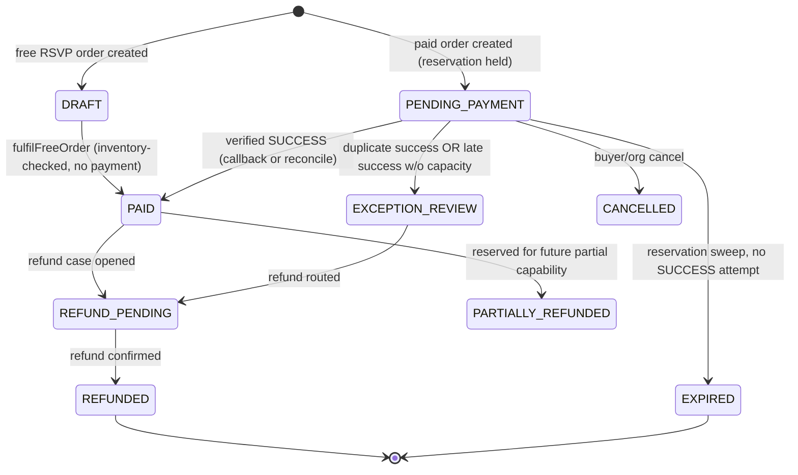
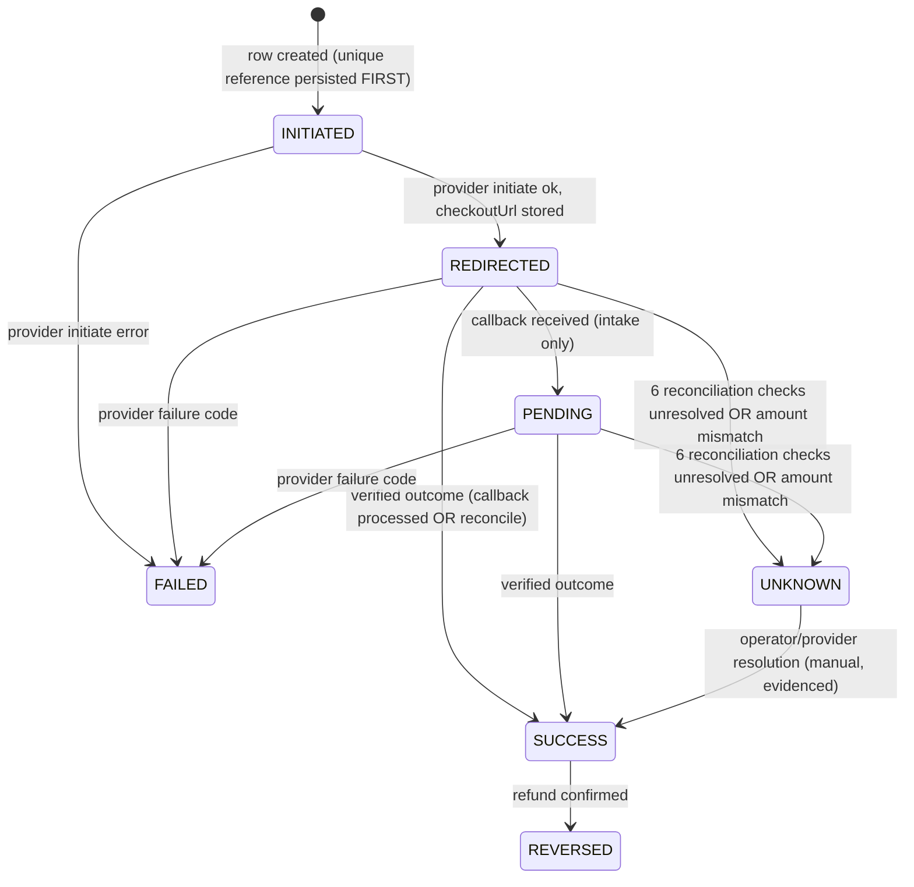
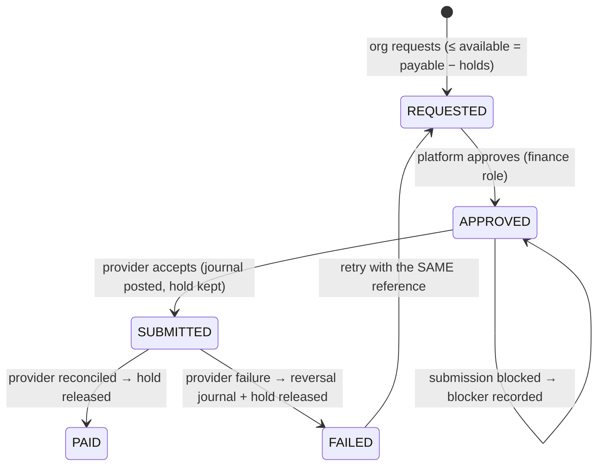

# iEventPlux — Payments & Settlements

| | |
|---|---|
| **Provider** | Hubtel v1 Online Checkout (collections) · Hubtel Send Money (payouts — externally blocked) |
| **Adapter** | `src/server/hubtel/payments.ts` · orchestration `src/server/services/payments.ts` · fulfilment `src/server/services/fulfilment.ts` · refunds/payouts `src/server/services/refunds.ts` |
| **Money unit** | Integer GHS pesewas (`*Minor`) end-to-end; display `₵1,234.56` (`src/server/money.ts`) |
| **Verification status** | Implemented against the published v1 contract; **not sandbox-verified** (no credentials in this environment) — see `PROVIDER_CAPABILITIES.md` |

---

## 1. Order state machine

Rules:

- A paid order's fulfilment is **one transaction**: status PAID + reservations CONSUMED + `soldCount`/`reservedCount` moves + tickets issued + invoice — guarded by a fresh status re-read inside the transaction.
- `EXPIRED` is only set when **no** attempt on the order is `SUCCESS` (expiry sweep re-checks); money never disappears with an order.
- `EXCEPTION_REVIEW` is the explicit parking state for duplicate/late payments — the customer is notified that the money is accounted for.
- `MANUAL_TRACKED` is a **RefundCase** status (see §7), not an order state: an order whose refund cannot travel the provider path stays `REFUND_PENDING` while its case is tracked manually.

## 2. PaymentAttempt state machine

- **The browser return URL never mutates payment state** — it is informational; `/api/v1/payments/return/{reference}` renders order status only.
- Amount verification: `SUCCESS` with a provider amount ≠ attempt amount ⇒ **REJECTED/UNKNOWN, never paid** (forged-amount scenario).
- `UNKNOWN` is an ops-queue state, not a silent failure — visible in admin → payments.

---

## 3. Fee model

Active `FeeVersion` snapshotted onto each order (`feeVersionId` + `feeSnapshot` JSON) at creation. Defaults (v0 fallback in `src/server/fees.ts`):

| Parameter | Value | Bearer |
|---|---|---|
| Ticket commission | 500 bp = **5%** | ORGANIZER (deducted from payable) |
| Processing fee | 195 bp = 1.95% | PLATFORM (informational; recorded, not charged to organizer/buyer) |
| SMS rate | ₵0.05/segment | billed to org quota/spend |
| Currency | GHS | — |

Refund policy embedded in the snapshot: *commission retained on refunds; processing costs borne by platform.*

### 3.1 Worked example — ₵400.00 order (1 × VIP at ₵400)

| Step | Computation | Result |
|---|---|---|
| Order total | buyer-side, server-priced | `40 000` pesewas |
| Platform commission | `bpOf(40000, 500)` = round(40000×500/10000) | `2 000` (₵20.00) |
| Organizer payable | 40000 − 2000 | `38 000` (₵380.00) |
| Processing (informational) | `bpOf(40000, 195)` | `780` (₵7.80) — platform-borne cost estimate, informational |

**Journal** (`idempotencyKey = order-payment:{orderId}:{attemptId}`, refType ORDER_PAYMENT):

| Account | Scope | DR | CR |
|---|---|---|---|
| `collections` | platform | 40 000 | |
| `platform_fees` | platform | | 2 000 |
| `organizer_payable` | org | | 38 000 |
| **Σ** | | **40 000** | **40 000** ✅ |

### 3.2 Worked example — refund of the same order

The buyer is refunded the **full remaining order total** (₵400). Confirmed refund ⇒ unused tickets → `REFUNDED` **first**, then a reversal journal that mirrors the original lines exactly (key `refund:{refundCaseId}`):

| Account | Scope | DR | CR |
|---|---|---|---|
| `platform_fees` | platform | 2 000 | |
| `organizer_payable` | org | 38 000 | |
| `collections` | platform | | 40 000 |
| **Σ** | | **40 000** | **40 000** ✅ |

Net effect: the sale's ledger footprint is fully unwound (collections, commission income and organizer payable all re-offset). The fee snapshot's policy text — "Commission retained on refunds; processing costs borne by platform" — is the commercial policy recorded for refund handling; the full-order reversal above implements the complete unwind, and any commercial deduction (where a provider or policy applies one) would be posted as a separate, explicit `ADJUSTMENT` journal rather than by editing history.

### 3.3 Worked example — ₵30.00 virtual pass with ₵5 group discount

Subtotal 3 000 → discount 500 → total 2 500 → commission `bpOf(2500,500)`=125 → payable 2 375. Journal: DR collections 2 500; CR platform_fees 125; CR organizer_payable 2 375.

### 3.4 Subscription payment journal

Invoice paid ⇒ DR `collections` (platform) / CR `subscriptions_revenue` (platform), key `subscription-payment:{attemptId}`. No organizer_payable involvement.

### 3.5 Payout journals

| Event | Journal (key) |
|---|---|
| Submission | DR `organizer_payable` (org) / CR `payouts_clearing` (platform) — key `payout:{payoutId}` |
| Failure | Mirrored reversal — key `payout-reversal:{payoutId}`; funds return to organizer_payable |
| Paid | Hold released; no new journal (clearing already balanced at submission) |

---

## 4. Callback handling rules

Provider callbacks land at `POST /api/v1/payments/callback` (`intakeCallback`, `services/payments.ts`):

| Rule | Behaviour |
|---|---|
| Prompt ack | Parse → redact → store `ProviderEvent` → enqueue `PROCESS_PROVIDER_EVENT` → HTTP 200 immediately. Business effects happen in the worker. |
| Reference resolution | `clientReference`/`token` (case-tolerant) must match a `PaymentAttempt.reference`. Unknown references are stored as REJECTED for forensics and fulfil nothing. |
| Dedup | `dedupKey = reference:transactionId:responseCode:amount` is unique; duplicate callbacks are acknowledged (`DUPLICATE`) and never re-processed. |
| Success code | `ResponseCode "0000"` = SUCCESS (case-tolerant field parsing — PascalCase or camelCase accepted). |
| Failure codes | `0001`–`0005` = FAILURE. |
| Amount trust | A SUCCESS with a mismatched amount is **rejected** (attempt → UNKNOWN); the provider event is marked REJECTED. |
| No signature invention | The v1 callback contract publishes **no HMAC/signature**; the implementation does not invent one. Integrity comes from controlled ingress + server-to-server verification + amount comparison. |
| Redaction | Card numbers, CVV, PIN, OTP, customer name, MSISDN removed before persistence (`parseCallback`); payload capped at 2000 chars. |
| Subscriptions | Attempts with `invoiceId` (no order) route to `applySubscriptionPayment` — same idempotency discipline. |

## 5. Reconciliation procedure

Sweep `RECONCILE_PAYMENT` (worker, every 60 s; admin "run now" available):

1. Select attempts `REDIRECTED|PENDING`, `initiatedAt` older than **5 minutes** (`reconcileAfterMinutes`), `callbackCount = 0`, `reconcileCheckCount < 6` (`maxReconcileChecks`), batch ≤ 25.
2. Server-to-server status check `GET {checkoutBase}/items/{token}` with Basic auth.
3. `reconcileCheckCount++`, `lastReconciledAt` stamped.
4. SUCCESS (+ amount match) ⇒ fulfil (idempotent — same code path as callbacks). FAILURE ⇒ attempt FAILED (order retryable with a new attempt). PENDING/unreachable ⇒ keep waiting.
5. After the **6th** unresolved check ⇒ attempt `UNKNOWN` ("Unresolved after maximum reconciliation checks") — surfaced to the ops queue; **never** auto-expired away, never re-charged, and never marked failed (the customer may genuinely have paid).

Rationale for the 5-minute rule: the provider contract advises waiting ~5 minutes before status-checking (avoid racing the payment pipeline); the implementation encodes it rather than polling aggressively.

## 6. Late & duplicate payment policies

| Scenario | Policy |
|---|---|
| **Late success** (SUCCESS arrives after the 15-min reservation expiry) | Try to re-reserve capacity transactionally (quota re-checked ⇒ never oversell). If capacity is gone: order → `EXCEPTION_REVIEW`, a full-refund `RefundCase` opens automatically (`system:late-payment`), buyer is notified with the refund amount — never "payment vanished". |
| **Duplicate successful payments** on one order | Second success does **not** re-fulfil: a `RefundCase` (`system:duplicate-payment`) opens automatically, order → `EXCEPTION_REVIEW`, buyer told the excess is accounted for and being refunded. |
| **Repeated callbacks for the same attempt** | Dedup key + attempt status guard ⇒ exactly one fulfilment; journal idempotency key ⇒ exactly one journal. |
| **Buyer retries after failure** | A new attempt with a **new unique reference** is created (`attemptNo` increments); expired holds are re-armed only if capacity allows. |

## 7. Refund policy

| Path | Status | Behaviour |
|---|---|---|
| Full-order MoMo refund (provider capability) | Implemented (simulator executes end-to-end; real adapter pending sandbox verification) | Request (org `refund:request`) → platform FINANCE_ADMIN processes **with elevation** → unused tickets revoked **first** → reversal journal (key `refund:{caseId}`) → case PROCESSED, order REFUNDED, buyer notified |
| Unsupported paths (partial/card refund, any path the provider does not advertise) | `MANUAL_TRACKED` | Case stays open with evidence and resolution note; **no fake money movement is ever recorded** |
| Repeat refund on same order | Blocked | `requestRefund` refuses a second open case; `processRefund` refuses re-processing a PROCESSED case |
| Refund amount | Full remaining order total | Partial refunds not offered (provider capability + product exclusion) |

Ticket revocation happens **before** money reversal is confirmed, so a refunded order cannot be used to enter meanwhile.

## 8. Payout lifecycle

- **Settlement holds:** approval creates a `SettlementHold` for the in-flight amount; `availablePayout = max(0, organizer_payable − holds)`; the hold is released on PAID or FAILED.
- **Holding period:** `payoutHoldDays` default 3 (platform setting) governs the settlement window policy.
- **Failure reversal:** `payout-reversal:{payoutId}` returns funds to `organizer_payable`; **retries reuse the same payout reference** — never a fresh reference for the same money (prevents double-payment on ambiguous failures).
- **External blocker:** without Send Money credentials + merchant agreement, `submitPayout` refuses (`PAYOUTS_BLOCKED…`) and the payout remains APPROVED with the blocker recorded — honestly blocked, not simulated success.

## 9. Provider limitations (honest statement)

| Limitation | Impact | Mitigation in place |
|---|---|---|
| **No sandbox/live verification yet** — no credentials were supplied with this assignment | Endpoint/field names must be re-verified against `https://code.hubtel.com/docs/guides/online-checkout` before production | Case-tolerant field parsing; contract rules implemented from the brief's §9; isolated simulator exercises the full internal path |
| **v1 callback contract has no signature/HMAC** | Callbacks cannot be cryptographically authenticated at ingress | Controlled ingress URL, unique references, dedup, server-to-server verification + amount comparison as the final authority |
| **Send Money externally blocked** (credentials + merchant agreement) | Payouts cannot be submitted to a provider | Full internal lifecycle + journals + holds work; blocker recorded; same-reference retry rule prevents double-pay later |
| **Refund capability limited to full-order MoMo** | Partial/card refunds unsupported | `MANUAL_TRACKED` cases with evidence; no invented endpoint |
| **Checkout status check documented ≥5 min after initiation** | Aggressive polling is wrong | Encoded 5-minute gate + max 6 checks |

## 10. Development simulator scope

`/api/v1/payments/simulator/{reference}` — an **isolated, development-only** payment panel:

- Active **only** while Hubtel checkout credentials are absent (`PAYMENTS_SIMULATOR=auto`); forcing it on in production throws at startup (`src/server/env.ts`).
- Everything below the provider boundary is **the real production code**: real orders, real attempts, real callback intake, real reconciliation, real ledger.
- Scenarios: `success` · `failure` (0002) · `forged-amount` (must be rejected) · `late-success` (waits out the reservation hold, then pays) · `duplicate-callback` (posts the same callback twice; must fulfil once) · `pending-forever` (no callback; reconciliation must resolve safely to UNKNOWN).
- The simulator UI is labelled "Development simulator" and shows the amount and provider as simulated.

Subscription invoices can also be paid through checkout — the same simulator and the same `applySubscriptionPayment` idempotency path apply.
