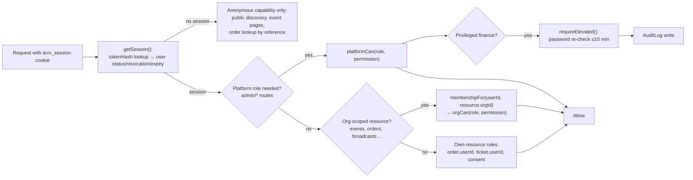

# iEventPlux — Permissions & Access Control

| | |
|---|---|
| **Source of truth** | `src/server/permissions.ts` (role matrices), `src/server/auth.ts` (sessions + elevation), `src/server/api.ts` (guards), `src/server/audit.ts` (trail) |
| **Principle** | Authorization is **session-derived**. A caller-supplied organization id *never* establishes authorization — it only scopes queries *after* membership has been proven from the session. |

---

## 1. Role model

Two independent role axes:

- **Platform roles** — stored on `User.role`: `USER`, `SUPPORT`, `MODERATOR`, `FINANCE_ADMIN`, `SUPER_ADMIN`.
- **Organization roles** — stored on `Membership.role` (one per user per org): `OWNER`, `ADMIN`, `EVENT_MANAGER`, `FINANCE`, `CHECKIN_STAFF`, `ANALYST`.

Org hierarchy (for `roleAtLeast` checks): OWNER 60 > ADMIN 50 > EVENT_MANAGER 40 = FINANCE 40 > CHECKIN_STAFF 20 > ANALYST 10.

---

## 2. Platform role matrix

Permissions from `PLATFORM_PERMISSIONS` (`permissions.ts`):

| Permission | SUPPORT | MODERATOR | FINANCE_ADMIN | SUPER_ADMIN |
|---|:--:|:--:|:--:|:--:|
| `admin:console` (access the admin console) | ✅ | ✅ | ✅ | ✅ |
| `admin:moderate` (reports, takedowns, suspensions) | — | ✅ | — | ✅ |
| `admin:finance` (refunds, payouts, ledger, fees) | — | — | ✅ | ✅ |
| `admin:settings` (platform settings, integrations) | — | — | — | ✅ |
| `admin:users` (user support actions) | ✅ | — | — | ✅ |

Notes:

- Ordinary `USER` accounts have no admin console access at all.
- Finance actions inside the console additionally require **elevation** (§5).
- Moderation actions by MODERATOR are audit-logged; SUPER_ADMIN overrides are, too.

## 3. Organization role matrix

Permissions from `ORG_PERMISSIONS` (`permissions.ts`):

| Permission | OWNER | ADMIN | EVENT_MANAGER | FINANCE | CHECKIN_STAFF | ANALYST |
|---|:--:|:--:|:--:|:--:|:--:|:--:|
| `org:manage` (org profile/settings) | ✅ | ✅ | — | — | — | — |
| `org:manage_team` (invite/remove members, assign roles) | ✅ | ✅ | — | — | — | — |
| `org:manage_payouts` (request/approve payouts) | ✅ | ✅ | — | ✅ | — | — |
| `org:view_finance` (finance summary, ledger views) | ✅ | ✅ | — | ✅ | — | ✅ |
| `event:create` / `event:edit` / `event:publish` | ✅ | ✅ | ✅ | — | — | — |
| `event:cancel` (cancel/postpone) | ✅ | ✅ | — | — | — | — |
| `tickets:manage` (ticket types, quotas, discounts) | ✅ | ✅ | ✅ | — | — | — |
| `orders:view` (orders + aggregates) | ✅ | ✅ | ✅ | ✅ | — | ✅ |
| `attendees:view` (attendee lists) | ✅ | ✅ | ✅ | — | ✅ | — |
| `checkin:scan` (scan + manual lookup + device sessions) | ✅ | ✅ | ✅ | — | ✅ | — |
| `broadcast:manage` (broadcasts, studio, ingest keys) | ✅ | ✅ | ✅ | — | — | — |
| `messages:send` (org SMS/email campaigns) | ✅ | ✅ | ✅ | — | — | — |
| `promotions:manage` (campaigns) | ✅ | ✅ | ✅ | — | — | — |
| `media:manage` (posters/gallery uploads) | ✅ | ✅ | ✅ | — | — | — |
| `refund:request` (open a refund case) | ✅ | ✅ | — | ✅ | — | — |

Deliberate shape: **ANALYST sees numbers but never people** (no attendee lists); **CHECKIN_STAFF sees people but never money** (no finance views); **FINANCE touches money but not event content**.

---

## 4. Resource-level rules

| Resource | Rule |
|---|---|
| Attendee lists | Org-only (`attendees:view`). Buyers' lists for an event are never public. Device check-in rosters are **minimized** — check-in staff get ticket codes/statuses, not buyer contact detail beyond what door operations need. |
| Broadcast ingest keys (OBS/vMix) | Organizer-only (`broadcast:manage`). Generated at broadcast setup, shown **once** to organizers, rotation supported; never returned again by the API. |
| Stream key rotation | `broadcast:manage` holders only; rotation invalidates the previous key. |
| Ledger & journals | Org scope: `org:view_finance`. Platform scope: `admin:finance`. Journals are append-only; no role can edit entries. |
| Fee versions & plans | Platform `admin:finance` (FINANCE_ADMIN/SUPER_ADMIN) + elevation; versioned, never mutated in place. |
| Refund processing | Platform `admin:finance` **+ elevation** (§5). Org-side refund *requests* (`refund:request`) do not require elevation. |
| Payout approval | Org `org:manage_payouts`; platform payout lifecycle actions are `admin:finance`. |
| Org-scoped endpoints | Authorization resolves `Membership` from the session for the org that owns the resource (`membershipFor`, `eventOrgAccess`); the org id in the URL is used for scoping *after* the membership check, never as proof of membership. |
| Event management | `eventOrgAccess(userId, eventId, permission)` fetches the event, resolves its org, checks membership + permission in one path — there is no route that trusts `?orgId=` for authorization. |
| Order access | Buyer (`order.userId`) or org `orders:view`. Anonymous buyers access orders only via the unique order reference (`ORD-…`). |
| Ticket transfers | Claim tokens are one-time, single-use, expiring; claiming requires an authenticated session. |
| Admin "run now" sweeps | `admin:console` + appropriate section role; executed via `sweepOnce` server-side. |
| Uploads | `media:manage` on the owning org; type allow-list (PNG/JPEG/WebP) and 5 MB bound enforced server-side. |

## 5. Elevation (privileged finance actions)

- Privileged platform-finance actions (processing refunds, payout lifecycle transitions) require a **recent password re-check**.
- Mechanism: `POST /api/v1/auth/elevate` verifies the password and stamps `Session.elevatedAt`; elevation is valid for **10 minutes** (`ELEVATION_TTL_MS`).
- Guards: `requireElevated()` in `src/server/api.ts` throws `ELEVATION_REQUIRED` (HTTP 401) when the window has lapsed; the admin console surfaces a password re-check prompt.
- Elevation attempts are rate-limited (5/min per IP) and audit-logged.

---

## 6. Privacy rules

| Rule | Enforcement |
|---|---|
| **UNLISTED events** are excluded from discovery, search and feeds | visibility filter in discovery queries (`services/events.ts`, `/api/v1/discovery/[view]`) |
| **INVITE_ONLY events** hide the venue address until approved RSVP | event detail projection gated on `Rsvp` approval; invitations (`code @unique`) carry guest limits and optional approval |
| **Interest privacy** — save/interested/going are private per user | `EventInterest` is never exposed cross-user; organizers see aggregates only |
| **QR payloads carry no personal data** | payload is `IEVX1.{ticketId}.{hmac}` (`server/qr.ts`); holder identity lives only server-side |
| **Payout redaction** | provider payloads and callback bodies are redacted before storage/logging (card numbers, OTP/PIN, customer names, MSISDNs removed — `hubtel/payments.ts parseCallback`) |
| **Consent registry** | MARKETING sends require `Consent` for (target, channel, MARKETING); otherwise SUPPRESSED. TRANSACTIONAL messages (receipts, reminders) do not require marketing consent |
| **Quiet hours** | marketing SMS blocked 20:00–08:00 organizer local time |
| **Dev verification codes** | exposed with a DEV label only when SMTP is absent — never in production |
| **Password reset** | code-based + **global session revocation** for the account on reset |
| **Session security details** | see `SECURITY_REVIEW.md` §2 |

---

## 7. Audit coverage

`AuditLog` (`entityType`, `entityId`, `actorId`, action, before/after snapshots) is written by `src/server/audit.ts` for privileged actions. Coverage:

| Area | Audited actions |
|---|---|
| Verification | Org verification approve/reject (reviewer, evidence) |
| Org lifecycle | Org suspend/unsuspend |
| Events | Platform event suspension |
| Moderation | Report resolution / content actions |
| Finance (elevated) | Refund processing (incl. MANUAL_TRACKED resolution), payout lifecycle transitions |
| Fees & plans | FeeVersion creation/activation, plan changes |
| Settings | PlatformSetting changes |
| Operations | Admin-triggered sweeps ("run now") |
| Auth-sensitive | Elevation grants, password resets (effect: sessions revoked) |

The admin console exposes the audit log as a first-class section (`/api/v1/admin/audit`) with entity-indexed lookup (`@@index([entityType, entityId])`).

---

## 8. Authorization decision flow

Key property: every box between the session and the action is a server-side check; the client's route (hash) and any client-supplied identifiers have no bearing on authorization outcomes.

## 9. Matrix verification coverage

The permission matrix is not just documented — it is enforced at concrete guard points, each exercised during scripted verification:

| Guard point | Code | Matrix rule exercised |
|---|---|---|
| Every `/api/v1/admin/*` request | `requirePlatformRole(...)` in route handlers | Platform matrix per section (finance sections additionally `requireElevated()`) |
| Org/event management routes | `eventOrgAccess(userId, eventId, permission)` | `event:*`, `tickets:manage`, `broadcast:manage`, `media:manage` |
| Org settings/team/payout routes | `membershipFor(...)` + `orgCan(...)` | `org:manage`, `org:manage_team`, `org:manage_payouts` |
| Attendee list endpoints | `attendees:view` check | ANALYST/FINANCE denied; CHECKIN_STAFF allowed |
| Check-in routes | `checkin:scan` check + `DeviceSession` token | CHECKIN_STAFF operational path |
| Messaging routes | `messages:send` check + consent/quota layers | EVENT_MANAGER allowed, ANALYST denied |
| Refund case processing | `admin:finance` + `requireElevated()` | FINANCE_ADMIN without elevation → 401 ELEVATION_REQUIRED |
| Org finance/ledger views | `org:view_finance` | ANALYST read-only included; CHECKIN_STAFF excluded |

Any new endpoint that touches org-scoped data must resolve membership through one of these helpers — that is the review checklist item for future pull requests.
